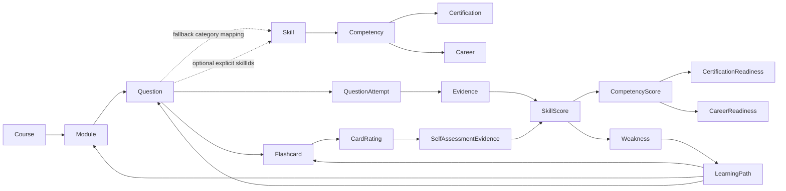

# IndustrialIQ Knowledge Graph

## Purpose and status

The knowledge graph connects learning content to skills, competencies, certification readiness, careers, and recommended work. The current graph is an in-memory product foundation, not a curated or published knowledge base.

Canonical implementation locations:

- [industrialGraph.ts](../src/analytics/industrialGraph.ts)
- [models.ts](../src/competencies/models.ts)
- [course.ts](../src/courses/industrial-automation/ignition-core/course.ts)
- [questions.json](../src/data/questions.json)
- [001_competency_intelligence.sql](../database/001_competency_intelligence.sql)

## Current node inventory

| Node type | Count | Current representation |
| --- | ---: | --- |
| Course | 1 | Ignition Core |
| Modules | 9 | One per existing topic category |
| Questions | 72 | Eight per module/category |
| Flashcards | 72 views of the 72 questions | Question-derived, not separate content records |
| Skills | 9 | Lowercase IDs derived from categories |
| Competencies | 5 | Weighted groups of provisional skills |
| Certification targets | 1 | `ignition-core-practice` |
| Career paths | 6 | Weighted competency targets |
| Learning paths | 0 persistent records | GPS routes, diagnostic steps, and generated weekly plan |

## Entity relationships

## Skills

The nine provisional skill IDs mirror the categories:

| Skill ID | Category/module |
| --- | --- |
| `gateway` | Gateway |
| `vision` | Vision |
| `perspective` | Perspective |
| `tags` | Tags |
| `security` | Security |
| `reporting` | Reporting |
| `historian` | Historian |
| `transaction-groups` | Transaction Groups |
| `alarming` | Alarming |

These are runtime calculation labels. They have not yet been reviewed as observable, assessable competencies at a stated proficiency level.

## Competencies

| Competency | Skills and weights |
| --- | --- |
| `automation-platform` | Gateway 1, Tags 2 |
| `operator-interface` | Vision 1, Perspective 2 |
| `data-integration` | Reporting 1, Historian 1.5, Transaction Groups 1.5 |
| `operations-reliability` | Alarming 1, Historian 1 |
| `industrial-security` | Security 1 |

The engine calculates a competency score from available weighted skill scores. Missing skills are reported and are not converted to zero.

## Certification

The single in-memory target is:

- ID: `ignition-core-practice`
- Name shown in the mentor: Ignition Core Practice Readiness / Ignition Core Certification
- Components: all five competencies with equal weight
- Purpose: practice planning and evidence-coverage summary

It is not an official Ignition certification blueprint and does not claim official topic weighting.

## Careers

| Career path | Competency target emphasis |
| --- | --- |
| SCADA Engineer | Automation platform, operator interface, and data integration |
| Controls Engineer | Highest emphasis on automation platform, plus operations reliability |
| Automation Engineer | Broad profile with extra data-integration weight |
| OT Security Analyst | Highest weight on industrial security |
| Industrial Cybersecurity Engineer | Highest weight on industrial security with a broad automation base |
| Reliability Engineer | Highest weight on operations reliability and data integration |

Each path stores target scores and weights. Role targets are provisional and must not drive employment decisions without independent validation.

## Questions

Each question has:

- Stable human-readable ID
- Category
- Prompt
- Four choices
- Correct choice index
- Explanation
- Optional `skillIds`

Current facts:

- 72 total.
- 8 in each of the nine categories.
- No question currently has explicit `skillIds`.
- The industrial adapter falls back from question category to the category-derived skill.
- A question response becomes assessed evidence; a flashcard rating for the same question is lower-weight self-assessment evidence.

## Modules and learning paths

The nine modules are generated from categories and contain the question IDs in each category. They are navigational content groups, not authored lesson sequences.

Three path-like outputs exist:

1. **Course modules:** static question groupings.
2. **Diagnostic learning path:** prioritized unpersisted skill-gap steps.
3. **Mentor/GPS paths:** regenerated route steps and a seven-day rhythm.

These outputs are not yet represented by a single versioned `LearningPath` entity.

## Flashcards

Every question is reused as a flashcard. The front is the question; the back is the correct option and explanation. There is no independent card count beyond the 72 question-derived cards.

Card progress is keyed by question ID:

- due timestamp
- interval in days
- review count
- latest rating

Flashcard ratings are explicitly lower-weight self-assessment than question or exam outcomes in the competency engine.

## Evidence relationships

Live evidence is derived from `Progress`:

- `question`: every saved answer; score 100 or 0, source reliability 0.8.
- `flashcard`: current saved card rating; scores 20/50/80/100 for Again/Hard/Good/Easy, source reliability 0.25.

The generalized engine also accepts:

- `exam`: source reliability 1.0.
- `module`: source reliability 0.5.

Live practice/exam responses are currently both stored as ordinary question answers; the saved progress schema does not record a per-answer mode or attempt ID.

## Proposed persisted graph

The SQL design separates:

- graph and content versions
- skills and competencies
- certification and career targets
- learner evidence and evidence-to-skill mappings
- skill/competency/readiness snapshots
- review states

It does not run in the current application. Before connecting it, the project needs backend authorization, graph publication, idempotency, version membership constraints, migration fixtures, and service ownership.

## Required graph invariants

1. IDs are unique within entity type.
2. Weighted mappings are positive and reference known nodes.
3. Published versions are immutable.
4. Prerequisites form a validated directed acyclic graph.
5. Categories and UI topics are not automatically competencies.
6. Unmapped content remains usable but must not create competency evidence.
7. Missing evidence stays `null`, never a fabricated zero.
8. Self-rating remains distinguishable from assessed evidence.
9. Every score must preserve graph, content, and algorithm identity.
10. Readiness must expose coverage, confidence, blockers, and uncertainty.
